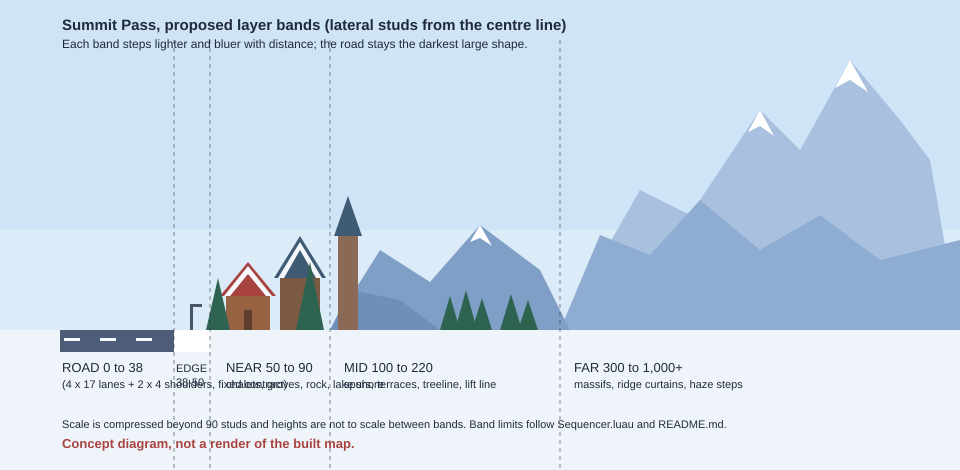
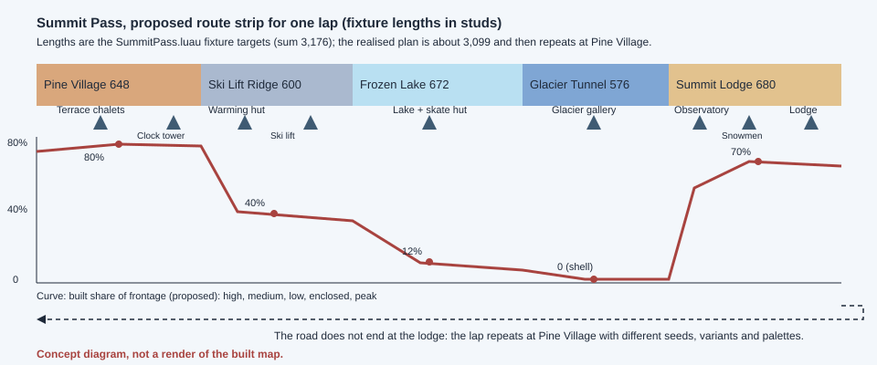

# Summit Pass redesign plan (Round 3, proposal only)

Written by worker P2 for Adam. **Nothing here is built, imported or uploaded.** The current Summit Pass preview stays exactly as it is until Adam approves. Every picture in `world-plans-assets/` is a hand-written "concept diagram, not a render of the built map". The sister plan for Dusty Highway uses the same template and the same camera and scale assumptions so the two can be compared.

Labels used throughout: **OBSERVATION** (read in a file or seen in a still), **CONTRACT INPUT** (an existing number, with its source), **HYPOTHESIS** (my proposal, to be tested in Studio), **UNKNOWN** (nobody has decided it; usually Brian R's road contract).

## 1. The plan in one page

The district vocabulary is still live in `src/lookdev/Downtown/City/Worlds/SummitPass.luau` (checked 2026-10-26): Pine Village, Ski Lift Ridge, Frozen Lake, Glacier Tunnel, Summit Lodge, in that order, repeating after the lodge. I keep all five names. The look stays bright alpine morning: pine green, warm timber, blue-white snow and ice, layered grey rock.

The preview's problem is not the palette. It is **shape variety and depth**: every chalet is the same height with the same red gable, the mountains are stacked cones, the ground is one flat white sheet, the lake does not read as a lake in any view I could check, the ski lift cable stops in mid-air, the tunnel is a see-through cage of hoops, and the lodge looks like a long chalet. The plan, in priority order:

1. **Backdrop first.** Replace stacked cones with a three-tier mountain system: a few asymmetric far massifs and one recurring "summit horn", ridge curtains in value steps, and sculpted foothill spurs.
2. **Near layer with height and setback rhythm.** Chalets from 12 to 34 studs, roof pitches from 30 to 58 degrees, a second rank set back on terraces, evergreen groves 26 to 44 studs tall, snow placed by slope instead of painted everywhere.
3. **One clear landmark per district**, each taller or wider than its neighbours by at least 1.5 times: clock tower, ski lift line, lake plane, glacier gallery, lodge.
4. **Frozen Lake becomes a plane**, at least 240 by 360 studs, with a dark shore rim and a 40-stud buffer from the road.
5. **Glacier Tunnel becomes a thick, opaque rock-and-ice gallery** with skylight and open bays, a horseshoe profile and no transparency.
6. **Ski lift becomes one coherent line** from base station to top station, towers grounded in slopes, cable well above any clearance.
7. **Hazards get their own visual grammar** and a "calm zone" before them.
8. **Motion stays small**: light bounded snow, at most five chimney smoke emitters, a bird flock, distant skiers and skaters. Nothing crosses the road.
9. **Budget and approval boundary**: build order, provisional phone targets, test plan, and the numbered decisions at the end.





## 2. Matched assumptions and contract inputs

Both World plans use these values. Distances to the road are **lateral studs from the centre line**.

| Item | Value | Status and source |
|---|---|---|
| Road | 4 lanes x 17 + 2 x 4 shoulders = 76 wide (half 38) | CONTRACT INPUT (PREVIEW, reversible), `City/README.md`, `Sequencer.luau` |
| Verge and frontage | 12-stud verge with 0.8 kerb; frontage line 50 from centre | CONTRACT INPUT (PREVIEW), `README.md` |
| Levels | road y 0, ground slab top -0.3, travel toward -Z | CONTRACT INPUT, `README.md`, `Assembler.luau` |
| Segments | Straight 96/192, Curve radius 360 (16 degrees, arc 100.5), Transition 96, BridgeDeck 192; heading kept within 32 degrees | CONTRACT INPUT (PREVIEW) |
| Chase camera | FIXTURE: 12 behind, 6 above, look 20 ahead, FOV 70. HIGH: 18, 10, 24, FOV 75 | CONTRACT INPUT (PREVIEW), `Chase.luau`; outline says 12 behind, 6 above, about 12 degrees down, FOV 70 |
| Speed | 70 studs/s in the chase harness. Real top speed and ramp | harness value is PREVIEW; real curve is UNKNOWN, Brian R's contract |
| Time at 70 studs/s | 100 studs = 1.4 s; 400 studs = 5.7 s; a 576 to 680 stud district = 8 to 10 s; one lap (3,099) = 44 s | arithmetic |
| Lap | Fixture targets 648 / 600 / 672 / 576 / 680 (sum 3,176); realised plan 3,099, then the lap repeats | `SummitPass.luau`, R2-W2 |
| Landmark spacing | 300 to 440 studs in this World's data (global default 500 to 700) | PREVIEW |
| Sign spacing | the same name never twice within 400 studs, either side | existing PLAN-CHECK RULE, `Sequencer.SIGN_GAP` |
| Span clearance | 26 studs under spans | PREVIEW |
| Hop arc height, run camera, streaming radius | not defined | UNKNOWN, Brian R |
| Stud to metre | 1 stud = 0.28 m | PROVISIONAL, never an identity |
| Seeds | 2207 default; 11, 77, 101, 314 used in checks | R2-W1 |
| Active window | lots: 1 segment behind, 6 ahead; masses: 2 behind, 14 ahead; up to 300 items placed per step | `README.md` |
| Scenery rules | anchored, no collision, no transparency, small props cast no shadow | recommended in `research/modular-city-composition.md` |
| Hazards in the route | one at most every 260 studs, 60 percent chance, only on Straight pieces after s 150, lanes 2 (crack), 3 (ice), 4 (bank); never on BridgeDeck, Transition or curves | `Sequencer.luau` lines 460 to 485; PREVIEW scenery |

**Bands** (lateral studs, used by every district below): ROAD 0 to 38; ROAD-EDGE 38 to 50 (shoulder verge, kerb, berm, lamps); NEAR 50 to 90 (lots are at most 24 deep, courtyards set back 8, 12 or 16); MID 100 to 220 (the planner puts midground masses 60 to 100 studs beyond the road edge); FAR 300 to 1,000 and beyond (the planner puts skyline masses 300 to 780 beyond the road edge, one per segment per side).

## 3. Why Downtown succeeds (shared section)

Stills compared: `downtown-1-main-street-theater-pothole-s215.jpg` and `downtown-2-midtown-intersection-s2060.jpg` (Studio Edit), plus Blender renders `B2-district-MS.png`, `B2-theater-after-120ahead.png` and `B2-district-HB.png`. Facts from `hud-round2.md` R2-D1 and the source.

1. **A continuous wall at three scales.** Facades sit on the 50-stud frontage line; ground floor 16 plus 12 per storey, so four to six storeys are 52 to 88 studs. Across a 100-stud street that is a height-to-width ratio of 0.5 to 0.9, so the sky is a slot (`downtown-1`). Measured mix over seeds: 13 percent two to three storeys, 41 percent four, 46 percent five or six, 1 percent towers.
2. **Near, mid and far each have a job.** Near: awnings, lamps, trees at 15 to 20 studs. Mid: taller blocks and tank roofs, chosen not stretched. Far: pale skyline shapes that step lighter with distance and a clock tower closing the view (`B2-district-MS.png`, `B2-district-HB.png`).
3. **Rhythm with exceptions.** Lots of 24, 36 and 48 studs, a courtyard or pocket park every 7 to 10 lots, a tree every second or third furniture slot, intersections opening the street wall (`downtown-2`).
4. **The road stays clean.** Nothing sits in the 76 studs but paint and the hazard. The pothole in `downtown-1` is the only pale rim with a dark centre on the road.
5. **Landmarks read by silhouette first.** The theater blade was raised from 55 to 88 so it clears six-storey neighbours and reads at 120 studs (`B2-theater-after-120ahead.png`).
6. **Signage you can read.** Original puns ("DASHBOARD DAISIES") on boards sized by the research rule (letter height at least a thirty-second of viewing distance), never repeated within 400 studs.
7. **Colour means something.** Warm brick against a cool grey road, teal and maroon awnings as accents, yellow only on crosswalks, orange and white only on hazards (D-03 and D-18 in `hud-rebuild-downtown-b.md`).
8. **Purposeful props.** Lamps and trees follow a rhythm; no tree or shelter within 40 studs of a hazard.
9. **Bounded life.** Pigeons, flags, cart steam, birds and a blimp, all off-road and reduced-motion aware.
10. **Joins.** Districts blend over 84 studs on each side of a boundary (2 to 3 lots) and start with a 96-stud Transition.

**Translation, not copying.** Alpine equivalents of these principles, not of the objects: (a) a corridor edge built from evergreens, rock cuts and chalets at several heights; (b) value steps by distance baked into colour; (c) one dominant silhouette per 300 to 440 studs; (d) the road as the cleanest, darkest large shape; (e) accent colours reserved by meaning; (f) rhythm made of repetition with controlled exceptions. Limits: the two Studio stills show Downtown at s 215 and s 2060 only, and I did not see Downtown mid-Harbor Bridge in Studio.

## 4. Diagnosis of the current Summit preview

Viewed: all four `summit-*` Studio Edit stills, nine Blender renders (five district samples, the bridge approach and on-span views, six landmark chase views). The Studio stills look lower than a 6-stud chase camera (the horizon sits near mid-frame and the car is absent), so I treat them as indicative. Blender renders are not Roblox pixels.

| Candidate problem | Verdict | Evidence and source fact |
|---|---|---|
| Repeated single-height silhouettes | **SUPPORTED** | `summit-1-pine-village-s150.jpg`: rows of near-identical brown boxes under one red gable, both sides; `W-district-PineVillage.png` the same. Source: Pine Village height bag low 8, mid 1, tall 0; building lots 12 to 20 studs high, all from one `chalet_body` plus `gable` recipe (`kit_summit.py`). |
| Too much undifferentiated empty ground | **SUPPORTED** | `summit-2-ski-lift-ridge-s850.jpg` and `summit-3-frozen-lake-district-s1213.jpg`: a flat white sheet between road and masses, a pale flat horizon in the centre. Source: ground is 2048-stud slab tiles in one colour (236,243,250) at y -0.3 (`Assembler.luau`); relief comes only from snowbank lots (7 to 8 high) and the cone-like peak and serac lots (34 to 48). |
| Arbitrary prop scatter | **PARTLY SUPPORTED** | Props come from district bags every 48 studs (pine, snowman, fence post, rock, barrel); the barrel also stands in for bench and bin; snowmen (7.4 studs) appear in four of five districts. No purpose logic (no woodpile at chalets, no kiosk at the lift). A lone snowman and barrels read as random in `summit-1` and `summit-3`. |
| Missing near-road frame | **NOT SUPPORTED** as stated | Lamps (15 studs), kerb and snow verge frame the road in all four stills. Related weakness **SUPPORTED**: the frame is low and sparse. Chalets are 12 to 20 and pines 14 to 24, interrupted only by frontage peak and serac lots (34 to 48) that are themselves the cones. |
| Weak landmarks | **SUPPORTED** for three, **NOT SUPPORTED** for two | Weak: chalet cluster (28 studs among 12 to 20 neighbours, `W-landmark-ChaletCluster.png` reads as more of the same), summit lodge (72 wide, 40 to 47 high, reads as a long chalet in `W-landmark-SummitLodge.png`), frozen lake (below). Strong: bell tower (`W-landmark-BellTower.png`) and observatory dome (`W-landmark-Observatory.png`). |
| Abrupt district joins | **SUPPORTED at the tunnel exit; CANNOT TELL elsewhere** | `summit-4-glacier-tunnel-exit-lodge-s2370.jpg` shows a brown red-roofed building right at the arch's exit. Source: the Glacier Tunnel district is Transition 96 + Straight 96 + 384 of deck = 576, so it ends exactly at the exit and the next Transition starts there. No stills exist at the other joins. |
| Insufficient far backdrop | **SUPPORTED** | Source: six sky unit meshes (two-to-four-tier five-sided stacks), one per segment per side, 100 to 210 high, 300 to 780 studs out; midground meshes number five. Stills: peaks crowd the frame edges, the centre horizon is empty (`summit-3`). |
| Repeated cones (extra) | **SUPPORTED** | `peak_mass` and `sky_unit` build stacked frusta; frontage lots `SP_Lot_Peak36_a`, `Peak48_b`, `Crag24_a` use the same recipe, so the cones stand right at the road; the Assembler scales mid masses non-uniformly to the planned size. Many near-identical blue cones with white caps in `summit-3` and `W-district-SkiLiftRidge.png`. |
| Frozen lake unreadable (extra) | **SUPPORTED** | No lake plane is visible in `W-landmark-FrozenLake.png`, `W-district-FrozenLake.png` or `summit-3`. Source: the lake is a 68 x 30 oval 0.45 to 0.5 studs above snow of nearly the same value, inside a 72 x 40 footprint, seen at a grazing angle. |
| Ski lift cable ends in the air (extra) | **SUPPORTED** | Source: towers at +/-22, cable from -30 to +30 only, 0.25-stud tubes, three static chairs per run. `W-landmark-SkiLift.png` shows the span running to the right tower and stopping just beyond it, with nothing continuing up a slope. |
| Tunnel reads as a cage then a glass pile (extra) | **SUPPORTED** | Source: twelve tubes of radius 4 with roof slabs on every other bay and no mountain around them. `W-district-FrozenLake.png` shows a see-through hoop from afar; `summit-4` shows striped, glass-coloured wall blocks. |
| Uniform snow coat | **SUPPORTED** | Every roof carries the same white cap in `summit-1`; every snowfield is one value. |
| Hazard readability in engine | **CANNOT TELL** | No Studio still shows a Summit hazard. In Blender the ice patch is a thin pale oval (`W-district-SkiLiftRidge.png`) and the snowbank carries orange stakes (`W-district-FrozenLake.png`). The Studio road is a mid blue near the hue of ice and shade (`summit-1` to `summit-4`). |

## 5. World-wide visual grammar

### 5.1 Palette and materials
Existing constants in `SummitPass.luau`: SNOW (238,244,250), ICE (176,214,238), ICE_DEEP (118,168,208), WOOD (150,98,66), WOOD_DARK (104,68,50), PINE (52,112,84), RED (204,72,66), GOLD (242,190,78), SLATE (110,124,146), CREAM (250,242,226).

| Role | Rule (HYPOTHESIS) |
|---|---|
| Snow | Three-step ladder already in the swatches (lit, half-lit, shade). Shade is a blue grey near (176,194,220) so snow has form. No large area at 245 or above. |
| Ice | ICE and ICE_DEEP only on glacier and lake, matte, never on roofs, props or road. |
| Rock | Near (112,118,130), mid (134,148,170), far (168,186,210), farthest (192,208,228). Far rock stays at least 10 value points darker than the horizon haze (206,222,244) so silhouettes survive. |
| Pine | Near PINE; mid (58,104,98); far groves (96,132,140). |
| Timber | WOOD and WOOD_DARK are the warm anchor; every district view carries one warm area. |
| Honey | GOLD for window glow, lantern and door accents, under about 3 percent of the frame. Static colour, no emissive flashing. |
| Roofs | Berry, forest (46,92,76), slate blue (63,91,115), weathered shingle (118,86,66), snow-cream; berry at most 40 percent of roofs in a district, kept out of the orange hue band. |
| Hazard orange | Only on snowbank stakes and cones. No orange anywhere else: no flames (firepit embers are honey), no bunting, no signs. White is not hazard-only here because snow is white; hazard white is the cap on stakes. |
| Bunting | Glacier teal, pine green, cream, honey, berry. |
| Material | Matte, one swatch palette per World (column "SU"), no photo textures, no transparency on any scenery. |

### 5.2 Lighting and haze
Keep the current values: ClockTime 10.6, Brightness 2.1, Ambient (104,118,146), OutdoorAmbient (142,158,186), ShadowSoftness 0.3, latitude 46; Atmosphere density 0.26, offset 0.18, colour (206,222,244), decay (150,170,206), haze 1.2; grade contrast +0.06, saturation +0.06.
- **To test, not apply:** a pale warm sun tint (ColorShift_Top near 255,244,228 instead of 228,238,255) so timber catches warm light while shade stays blue. If it washes the snow, drop it.
- **Haze rule.** Do not raise Atmosphere density above about 0.30. Distance fading is baked into far meshes as colour steps, so haze finishes the job and never hides weak geometry. If a far silhouette needs more fog to look right, the mesh is wrong.
- No bloom, sun rays or added lights. Warm windows are painted colour.
- Cables, lift towers, signs under 4 studs and all mid and far masses cast no shadow, so thin shadow lines never cross the lanes and mimic cracks.

### 5.3 Road readability rule
The asphalt is the darkest large shape in every frame. Luminance contrast against the snow verge should be at least 3 to 1 (the current slate, judged by eye from the Studio stills as about (108,140,190), would give roughly 3.1 by my arithmetic; measure the real swatch, then retune it if it falls short). No scenery ice, snow patch, puddle or crack-like line inside the carriageway or within 4 studs of its edge. Nothing near the road edge is as dark as asphalt or as saturated as lane paint.

### 5.4 Hazard distinction
Frost crack, ice patch and snowbank with plow stakes stay the hazard set. They are told apart from snow and ice variation by six channels:
1. **Place.** Hazards sit in lanes. Scenery ice and snow stop 4 studs outside the road edge.
2. **Shape.** Hazards are crisp ovals or rim-defined shapes; scenery ice is irregular facets.
3. **Value polarity.** The hazard patch is lighter than asphalt by at least 15 value points with a dark rim, and cracks are dark on pale. Lake cracks are the reverse: fine pale lines on deep blue.
4. **Hue.** Orange and white stakes belong to the snowbank hazard only.
5. **Calm zone** (HYPOTHESIS, extends the existing 40-stud tree rule): for 120 studs before a hazard, no bunting, no pennants and no glare patch within 24 studs of the road edge on either side, and no landmark within 60 (existing).
6. **Test.** Desaturate, downscale to 640 x 360, and have someone who did not build the stills pick the hazards out of ten frames.

### 5.5 Mountain shape hierarchy (large masses, medium separation, selective near detail, haze)

| Tier | Lateral distance | Height (HYPOTHESIS) | Job and shape language | Repeat limit |
|---|---|---|---|---|
| Far massifs | 700 to 1,200 | 160 to 360 | The big silhouette. Asymmetric, off-centre summit, two or three shoulders, one or two notches, six or more face planes of different value. One recurring **summit horn** 340 to 420 high. | no identical silhouette within 800 studs; one horn per lap in full view |
| Ridge curtains | 300 to 700 | 60 to 140 | Medium separation. Jagged tops with 8 to 14 uneven vertices, two or three bands each lighter than the one in front. | band meshes rotate; no mesh twice in a row |
| Spurs and foothills | 100 to 220 (terraces to 260) | 40 to 120 | Sculpted lumps with strata lines, snow-filled gullies, pine bands, piste glades. | five or more distinct meshes, mirrored variants authored not scaled negative |
| Near detail | 38 to 90 | 3 to 46 | Rock cuts, ledges, berms, roofs: the only tier with fine detail. | per-lot variants |

Shape rules: snow lies only on faces within about 35 degrees of horizontal and in gullies, steeper faces show rock; snow line near 55 percent of height on near masses, lower on far ones; no radial symmetry; no stacked frusta; no smooth blobs (every mass has facets and at least three strata bands). Far masses are placed by the planner but **vista anchors** (a few per lap) sit on the outside of curves, 1,000 or more studs out, so they stay in the forward view for 3 to 5 s. Six curves per lap give about six anchors. Arithmetic from the research note: height h at distance d is about 514 x h / d pixels on a 720-pixel phone view, so a 320-high horn at 1,100 studs is about 150 pixels, a clear shape.

### 5.6 Snow rules
Snow sits where it would: on roof pitches under about 45 degrees (steeper A-frames shed it and show timber), on porch roofs, window sills, ledges, fence rails, upper surfaces of pine boughs, and in drifts against uphill walls. Vertical walls get none. Sun-facing roof patches thin near chimneys. Ground snow has three value steps, trunk bases get sunken rings, and berms are uneven and blue-grey at the base. **Snowfall** is the existing single light emitter (rate 26 per second, size 0.4, thinned to 8 in reduced motion); no gusts, no visual blizzard.

### 5.7 Repetition rules
- No module twice within 3 lots on a side; never mirrored across the road (existing checks). **Added (HYPOTHESIS):** adjacent lots differ in eave height by at least 4 studs or in roof form; no more than 40 percent of any district's roofs share a colour; the same mass mesh is not reused within 600 studs.
- Chalets alternate ridge direction (parallel or across the road) and roof pitch.
- No more than one snowman per district tied to a yard (bag weight lowered).

### 5.8 Scale (HYPOTHESIS)
At the provisional 0.28 m per stud a 14-stud pine is under 4 m, so the preview's pines read as shrubs beside a 76-stud road. A deliberate stylised exaggeration:

| Element | Now | Proposed |
|---|---|---|
| Near pines | 14 (prop) to 24 (grove lot) | 26 to 44, in clumps of 3 to 5 at mixed heights |
| Chalets | 12 to 20 | 12 to 34 (one 3-storey inn per 300 studs) |
| Bell tower | 52 | 64 |
| Lift towers | 34 to 44 | 40 to 72 |
| Tunnel | crown 40, ellipse | walls 28, crown 46 |
| Lodge | 40 to 47 | great hall 46 to 58, wings 28 to 32 |
| Mid band | 30 to 90 | 40 to 120, terraces to 160 |
| Far | 100 to 210 | 160 to 360, horn 340 to 420 |

### 5.9 Ambient motion grammar
Motion is small, off-road and bounded. **Decorative motion never crosses the playable corridor without gameplay approval.** Everything uses fixed pools (no per-frame creation), a Trove for cleanup, and the existing 0.1 s accumulator with `BulkMoveTo`. Reduced motion (the Roblox setting or the preview override): snow thins, smoke thins, birds glide, skiers, skaters and chairs rest, flags stay still. **Smoke pool.** The cap is five emitters alive at once. In the current code the five are fixed to the first five chimneys in route order (`WorldLife.luau` lines 225 to 254, read, not run), so later districts and laps get none; the plan asks for a pool of five that re-homes to the chimneys within 350 studs (a Lane 3 lookdev change after approval).

### 5.10 Finishing on every side
The chase camera sees an object's approach end wall, then its facade, then its rear end wall, and its roof from above. So: closed meshes with painted backs; foundations 1 to 2 studs below ground with a snow skirt; steps and porch posts reach the ground; pine trunks flare into a snow ring; rocks sit in a drift; lamp and fence posts have a 2-stud collar; bridge and tunnel deck edges meet the kerb through a guard rail; portal footings go 6 studs below the deck; the berm covers the seam between road mesh and ground slab; nothing floats and no back face is open.

## 6. Density curve and variation

| District | Fixture length | Built share of frontage | Building height | Mid layer | Far layer | Energy |
|---|---|---|---|---|---|---|
| Pine Village | 648 | about 80 percent | 12 to 34, tower 64 | terraces with a second chalet rank | two ridge curtains, horn glimpsed | warm, busy |
| Ski Lift Ridge | 600 | about 40 | 10 to 24, lift 40 to 72 | piste glades, lift line | two ridges, horn clearer | open, active |
| Frozen Lake | 672 | about 12 | 8 to 18 | lake plane, far-shore treeline | one huge massif, ridges | calm breath |
| Glacier Tunnel | 576 | 0 (the shell is the frontage) | to 46 | glacier body | massif above ice | compress, then release |
| Summit Lodge | 680 | about 70 | 14 to 58 | knoll, terraces | three ridge bands, horn full | peak |

The curve falls and rises (high, medium, low, enclosed, peak) and no neighbour is within 20 points of another, so the lap breathes about every 600 studs.

**How repeats gain variation without incoherence** (all HYPOTHESIS except where marked existing):
- **Deterministic seeds** (existing): one stream in route order; the same seed and kit give the same plan. Test seeds 2207, 11, 77, 101, 314.
- **No immediately identical lot composition** (new check): the lot sequence of a district in lap n+1 may match lap n in at most half its positions.
- **Landmark variants:** each Tier A landmark gets variants A and B (different roof colour, flag, window pattern, porch side); variant = (lap + seed) modulo 2.
- **Controlled district weighting:** Pine Village low 5 / mid 3 / tall 1; Ski Lift Ridge low 4 / mid 3 / tall 0; Frozen Lake low 6 / mid 1 / tall 0; Summit Lodge low 3 / mid 4 / tall 1 (class bands: low up to 20 studs, mid 21 to 34, tall 35 and up).
- **Sign spacing:** the existing 400-stud rule; at most four signs per 300 studs.
- **Compatible joins:** new lots keep widths 24, 36, 48, depth at most 24, pivot at the front-left corner, facing -Z; asymmetrical lots ship as separate L and R meshes. Masses use bottom-centre pivots and free 90 degree yaw.
- **Shared meshes:** walls, roofs and porches are shared across lots through the one swatch palette; palette swaps use the three palettes each district already declares.
- **Landmark spacing:** majors (one per district signature) at least 500 apart, minors at least 250 from a major, all inside the existing 300 to 440 setting.
- **Transitions:** lots blend 50/50 over 84 studs (existing); far and mid meshes within 150 studs of a boundary draw from both districts' lists (new, optional).
- **Endless continuation:** the Summit Lodge Transition leads straight back into Pine Village. No arch, gate or wall crosses the road after the lodge, and the "WELCOME TO SUMMIT PASS" span is a question for Adam (Approval 9) because it repeats every lap.

## 7. The five districts

Every district uses the same fields. Camera: the FIXTURE chase camera at 70 studs/s. Pixel sizes use the research-note rule (about 514 x h / d pixels on a 720-pixel phone view). Kit names are proposed and keep the `SP_` prefix. R = reuse as is, W = rework an existing mesh, N = new.

### 7.1 Pine Village (fixture 648 studs, about 9 s)

- **First impression.** A warm timber village in morning sun: rooflines stepping up and down, chimney smoke, a clock tower in the middle distance, white peaks behind. The warmest district.
- **Entrance (first 150 studs).** Lap 1: the existing "WELCOME TO SUMMIT PASS" span at s 60. Two evergreen groves 30 to 44 high at 58 to 70 lateral form a green gate; the first chalet row beyond; the spire and one ridge at the horizon centre.
- **Road-edge.** Uneven plowed berms (24, 36, 48 long, 2 to 4 high), timber lantern lamps every 48 studs, snow poles, split-rail fence before courtyards, drift wedges at building bases.
- **Near.** Three ranks: a front row on the 50-stud line (12 to 24 high), a set-back row at 58 to 66 (courtyard lots with fenced yard, woodpile, sled) and groves of 3 to 5 pines 26 to 44 high. Every 300 studs: one 2.5 to 3 storey inn, three low cabins or sheds, at least three roof colours. Snowfield pockets every 5 to 8 lots (existing `treatmentEvery`).
- **Mid.** A foothill terrace at 100 to 200 holding a simplified second rank of chalets 8 to 20 studs higher, a pine band, one spur.
- **Far.** Two ridge curtains and a massif; the summit horn glimpsed on the first curve.
- **Landmark.** The **clock tower** (major), 64 high, about 2.2 times its neighbours: timber base, cream clock stage with a face toward the road, slate-blue spire, gold finial, on a set-back green with fence and two firs. Approach: at 240 studs the spire is about 137 px tall between smoke and ridge; at 120 about 274 px with the clock face turned to the road. Passing: green, fence and chalets frame it. Exit: it shrinks behind the next cluster. The **terrace chalets** (minor) replace the flat cluster: four chalets climbing a bank, eaves 14, 20, 26, 18, one shared yard.
- **Families.** Buildings: log low (30 degree roof), board-and-batten mid (40), steep A-frame (58, sparingly), hip with dormers, stone-base bakery, mono-pitch shed, duplex, three-storey inn, hall. Nature: snow-laden spruce, young fir, wind-bent pine. Props: woodpile, sled, ski rack, lantern lamp, bench, snow pole, fewer barrels, at most one snowman beside a yard.
- **Signage.** Blade signs facing the approach, 14 to 26 wide, letters 5 studs or more. Existing names: PINE CONE CAFE, MITTEN MARKET, WARM WAFFLES, COCOA CORNER, SLED AND BREAKFAST, BOOT DRYER INN, ICICLE ICE CREAM. Proposed: LOG PILE BAKERY, YODEL YARN, FIRESIDE BOOKS. Same name not within 400 studs; at most four boards per 300.
- **Palette and light.** Timber, cream, honey accents, mixed roofs (5.1); sunlit faces warm, shade faces blue.
- **Ambient motion.** Up to three chimney emitters near the camera (existing rate 4 per second, 1.5 in reduced motion; the pool of five is shared across the World, see 5.9), shared snowfall, bird flock; a tower flag may sway outside the corridor and rests in reduced motion.
- **Hazard visibility.** The busiest district, so the calm zone matters: 120 studs before a hazard no bunting and no strong red or honey sign within 24 studs of the edge. No orange roofs.
- **Transition to Ski Lift Ridge.** Lots thin and widen, groves thicken, rock shows through snow, the first open slope appears on the right, and the lift base shed arrives in the last 100 studs; roofs move from berry and green to slate.
- **Reusable kit.** R: `SP_Prop_Pole`, `SP_Prop_FencePost`, `SP_Prop_Barrel`, `SP_Lot_Snowfield24/36`, `SP_Lot_Firepit36_a`, `SP_Lot_Pines36_a`, `SP_Lot_Pines24_b` (taller). W: `SP_LM_BellTower`, `SP_LM_ChaletCluster`, `SP_Lot_Chalet24_a`, `SP_Lot_Chalet36_b`, `SP_Lot_Cabin24_a`. N: the chalet forms above, `SP_Edge_Berm_A/B/C`, `SP_Fol_Spruce`, `SP_Fol_Fir`, `SP_Fol_BentPine`, `SP_BG_Terrace_A`.
- **Optional.** A frozen creek and plank footbridge beside the road; a second honey tone for painted window glow.

```
  horn glimpse      ridge curtain        ridge curtain
      /\       __/\__       __/\_     /\
  ___/  \__  terrace chalets   ^ spire ^   chalets terrace
  groves [chalet]  [chalet]    | clock |    [chalet] groves
  ===== berm =====    R O A D    ===== berm =====
```

### 7.2 Ski Lift Ridge (fixture 600 studs, about 8.6 s)

- **First impression.** The mountain opens up: a wide white slope with cleared ski runs and a lift line climbing into the sky, grey rock, berry chairs. The world gets bigger.
- **Entrance.** A rock cut on the left (8 to 16 high, strata, snow on ledges); the lift base shed and a ticket kiosk on the right 100 to 150 studs in, the first tower rising behind. The summit horn shows clearly over the top station.
- **Road-edge.** Rock cuts alternating sides, berms, snow poles, split-rail on curve outsides. Static fence only.
- **Near.** Base station, warming hut, boulders in groups of three (never single), wind-bent pines, sleds, ski racks.
- **Mid.** Foothills with cleared glades 40 studs wide at 120 to 260, the lift line climbing one, snowcat tracks modelled into the slope mesh.
- **Far.** Two ridge curtains and a massif; the lift line points at the horn.
- **Landmark.** The **ski lift** (major): towers 40 to 72 high, shorter on high ground, concrete footings with snow skirts, a catenary cable from the base station to a top station on the ridge that carries on out of sight, chairs in berry and teal. Cable tubes at least 0.8 stud thick so they stay visible at 150 studs. Approach: at 240 studs a thin diagonal with a few chairs against sky. Passing: an A-frame tower in a rock outcrop beside the road, then the span overhead. Exit: chairs recede. The **warming hut** (minor): mono-pitch roof, chimney, bench.
- **Lift motion, kept safe.** *Default (no new approval):* the crossing span is static, at least 64 studs above the deck (the 26-stud span clearance is a preview value and the hop apex is UNKNOWN, so the margin is wide); chairs on the crossing are fixed; only the parallel legs at least 60 studs from the road edge carry up to six chairs at about 3 studs per second on a looped path (`BulkMoveTo`, Trove cleanup, rest in reduced motion). *Option M:* chairs also pass over the corridor at 64 or more studs; that needs Brian R's hop-apex number and Adam's approval. Either way it is decoration: it carries nothing, loads nothing, takes no input.
- **Distant slope activity.** Up to eight skiers (two parts each) on two glades 120 or more studs from the road, looping 60 to 120 studs; colours from the bunting set, never orange.
- **Families.** Buildings: lift shed, warming hut, kiosk, two cabins. Nature: wind-bent pines, rock outcrops, glade tree-lines. Props: ski rack, sled, snow pole, trail markers with original animal icons (fox, owl, pine cone).
- **Signage.** RIDGE LIFT TICKETS, SNOWFLAKE SKIS, HOT SOUP STOP, COCOA WARMING HUT, FROSTY FUEL. Proposed: GOGGLE GARAGE.
- **Palette and light.** The greyest district: slate rock, white snow, berry and teal chairs, honey on the hut window.
- **Ambient motion.** Birds, skiers, chairs, one smoke emitter (hut), shared snowfall.
- **Hazard visibility.** Rock cuts throw soft shade over the road; no tower within 24 studs of a hazard; cable and towers cast no shadow, so no thin dark line can pass for a crack.
- **Transition to Frozen Lake.** The slope drops away on the left, the horizon opens, the rock cut ends, pines thin, and a pale flat shape shows ahead.
- **Reusable kit.** R: `SP_Lot_Shed36_a`, `SP_Lot_Rocks36_a`, `SP_Lot_Crag24_a`, `SP_Prop_Rock`. W: `SP_LM_SkiLift`, `SP_LM_WarmingHut`, `SP_Mid_Slope_1/2`. N: `SP_Anim_Chair`, `SP_LM_LiftTop`, `SP_Edge_RockCut_A/B/C`, `SP_BG_PisteGlade_A/B`, `SP_Prop_TrailMarker`, and a static `liftCable` planner span (Lane 3 lookdev only).
- **Optional.** A parked snowcat at the base; the tier B sled hill as a glade feature.

### 7.3 Frozen Lake (fixture 672 studs, about 9.6 s)

- **First impression.** A calm pause after the climb: a wide pale lake on one side, dark pines on the far shore, mountains rising straight out of them, tiny skaters. The lowest density, the widest sight lines. The lake lies on the outside of the curve so the view opens as the road bends.
- **Entrance.** The last lift tower falls behind, the berm drops under 3 studs, a dark rock rim and a fence line appear, and the first pale plane shows beyond a shore buffer.
- **Road-edge.** Low berm, split fence every 24 studs on the lake side, snow poles, and a 2 to 4 stud band of dark rip-rap at the berm foot so snow and ice never touch.
- **Near.** A shore buffer at least 40 studs wide (snow, rock, frozen reeds), so ice starts 90 or more studs from the centre line. The skate hut and pier stand on the buffer.
- **Mid.** The ice plane, at least 240 wide and 360 long, matte pale cyan with a deeper blue heart, 0.5 to 1 stud above the snow inside a 2 to 4 stud dark rim so it reads as a bowl. A far-shore treeline band 30 to 40 high at 330 to 380. Fishing huts 120 to 200 studs out.
- **Far.** One huge asymmetric massif at 500 or more, two ridge curtains, the horn to one side.
- **Landmark.** The **lake plane** with **skate hut** and **pier**. It reads as a flat bright shape with skater dots, one chimney and a pier line, not a tall silhouette. Approach: at 240 the far edge shows beyond the bend; at 120 the whole plane. Passing: hut and pier. Exit: the shore curves away and the plane narrows to a pale wedge.
- **Lake versus road, and no shortcut.** Three barriers read in every frame: the dark rim, the buffer and the fence. No gap in the berm, no ramp, no track onto the ice. No shortcut is proposed; if Lane 1 ever wants one it needs its own design with a signed ramp-in and a different surface, never an unmarked gap.
- **Families.** Buildings: skate hut, two fishing huts, pier. Nature: frozen reeds, rim rocks, ice ledges, treeline band. Props: bench, skate rack, snow pole, fence.
- **Signage.** None on the route (district `signs = false`); the hut carries its own board, SKATE RENTAL HUT (proposed alternative: SKATE SWAP).
- **Palette and light.** Pale cyan ice, deep blue centre, snow, dark pines, a honey door; skaters in teal, berry, gold.
- **Ambient motion.** Up to six skaters (two parts each) on two loops 120 or more studs from the road, one smoke emitter (skate hut), birds, snow. Skaters rest in reduced motion.
- **Hazard visibility.** The lake is the biggest pale area in the World and must not mimic the ice-patch hazard: it is matte, textured and deeper in value; its cracks are pale on blue (the reverse of the hazard); it starts 40 or more studs away. Nothing oval and glossy appears off-road.
- **Transition to Glacier Tunnel.** The plane tapers, the far-shore massif narrows into a glacier snout, ice ledges give way to grey moraine and dirty snow, and the portal shows 280 to 330 studs ahead.
- **Reusable kit.** R: `SP_LM_SkateHut`, `SP_Lot_Pier36_a`, `SP_Lot_Ice24_a`, `SP_Lot_Ice36_b` (as shore ledges), `SP_Prop_FencePost`. W: `SP_LM_FrozenLake` (a rim-and-hut set, no oval). N: `SP_FL_Plane_A/B` (96 x 96 and 192 x 96 tiles), `SP_FL_Rim_A/B/C`, `SP_FL_FishHut_A/B`, `SP_Fol_Reeds`, `SP_BG_TreelineBand_A/B`, `SP_Anim_Skater`. The plane is a companion placed with the landmark: a small Lane 3 lookdev data addition.
- **Optional.** An ice-fishing hole and sled trail by the huts.

```
        massif (asymmetric)           ridge curtain
   ____/\______      _/\__     __/\______
   far-shore treeline ~~~~~~~~~~~~~~~~~~~~~~
    [ ice plane: matte, pale, crack lines ]   hut   pier
   rim rocks ====== buffer (snow, reeds) ===== fence
   ===== berm =====    R O A D
```

### 7.4 Glacier Tunnel (fixture 576 studs: Transition 96, Straight 96, deck 384; about 8.2 s)

- **First impression.** The road goes into the glacier: a huge blue-white ice cliff flanked by dark rock, a thick framed opening, cool shade inside with sunlit shafts, a bright but readable exit.
- **Entrance.** Moraine rubble and dirty snow lead to a portal with a thick rock-and-ice lip (at least 24 studs of visible depth), a snow cornice and two ice-fall columns. Flank walls run 64 studs each way, so the opening is cut into a mass, not a hoop. The opening reads dark blue, never black, with a small bright exit at the end.
- **Interior profile.** A horseshoe: vertical walls to 28 studs at 58 lateral (116 clear width against the 76-stud road, so 20 studs each side for camera, rail and kerb), crown 46, so there are at least 26 studs of clearance over the whole carriageway (the current ellipse gives about 29 at the road edge and 18 at the verge). Twelve bays of 32 studs (the existing rib spacing): closed bays, sky-window bays (a 16-wide roof opening) and gallery bays (open on one side behind three rock-ice piers). A seeded pattern puts at least three openings in twelve bays, for example bays 2, 5, 6, 9, 11. Each bay boundary has a ring rib one step lighter than the shell so depth reads.
- **Coherent material.** Horizontal strata continue across portal, walls and roof: three ice tones and two rock tones in a fixed order; thick convex lumps, no hair-thin ribs. Icicles only near portals and sky windows, at most 8 long, tips 30 or more above the deck.
- **Transparency and overlap.** None; everything is opaque. One roof shell per bay, ribs 2 studs proud, no coplanar overlapping sheets, so no glass pile and no flicker. The "sun shaft" is a lighter road colour plus real shadow, not a transparent cone.
- **Exit exposure.** The portal-out has a dark thick rim. For 120 studs beyond it the near layer is rock and dark pine, not a white snowfield. Seen from 120 studs inside, the aperture must hold road, a pine band and a ridge line, not only sky. No bloom, no extra fog. Traffic stays dark against the ground.
- **Layers.** Edge: heavy rock kerb, guard rail, wall lanterns. Near: portal and wall. Mid: the glacier body rising 120 to 200. Far: the big massif and the horn above the ice.
- **Landmark.** The **glacier gallery** (major). Approach: at 300 studs the cliff reads as a blue-white wedge in the road's direction; at 240 the portal is about 94 px tall, at 120 about 188 px with the lip filling the frame. Passing: ribs and shafts. Exit: the lit aperture grows and the lodge ridge shows.
- **Families.** Wall, bay, portal, ice-fall, moraine boulders; sparse hardy pines near the exit only; wall lanterns (honey, static), reflector posts, guard rail.
- **Signage.** The portal plate GLACIER TUNNEL (existing label) only; no shop signs.
- **Palette and light.** ICE, ICE_DEEP, slate rock, honey lanterns; shade cool from the real roof shadow, sun patches warm.
- **Ambient motion.** Shared snowfall only. The emitter box must stay outside the shell so flakes never spawn inside (a build check).
- **Hazard visibility.** The planner never places a hazard on a BridgeDeck, so none sits in the 384 studs. One may sit on the Straight 96 before the portal; there the calm zone applies and the moraine holds no pale glossy shapes.
- **Transition to Summit Lodge.** Not abrupt: a 96-stud forest saddle of dark pines opens to the lodge ridge. The near layer must change before the exit (the preview puts a building at the exit mouth).
- **Reusable kit.** R: `SP_Lot_Serac36_a`, `SP_Lot_Serac48_b`, `SP_Mid_Glacier_1` (re-tinted flank), `SP_Prop_Pole`. W: `SP_LM_GlacierTunnel384`. N: `SP_GT_PortalIn`, `SP_GT_PortalOut`, `SP_GT_Bay_A/B/C`, `SP_GT_BaySky`, `SP_GT_BayGallery`, `SP_GT_Wall_A/B`, `SP_GT_IceFall`, `SP_Edge_Moraine_A/B`, `SP_BG_GlacierSnout`.
- **Optional.** A short side opening showing a distant lit ice cave.

```
          snow cornice
      _______/======\_______
    / ice-fall |  dark blue  | ice-fall \
   |  rock lip |  opening    | rock lip |    (lip at least 24 deep)
   | wall 64   | ribs recede | wall 64  |
   === moraine === R O A D === moraine ===
```

### 7.5 Summit Lodge (fixture 680 studs, about 9.7 s)

- **First impression.** The destination: a large warm lodge on a rise, honey windows, chimney smoke, flags and bunting, a white observatory dome on the ridge behind, the summit horn in full sun. The warmest and tallest district.
- **Entrance.** After the forest saddle the road curves gently with the lodge on the outside of the bend, so the lodge ridge sits in the forward view 250 to 400 studs ahead, backed by the horn.
- **Road-edge.** Timber lanterns, roadside bunting poles, trail markers, a low stone wall along the lodge frontage.
- **Near.** Lodge wings and courtyard, the firepit lot (honey-gold embers and a smoke wisp, no orange flame), the snowmen row, groves.
- **Mid.** A terraced hill under the lodge; a rock knoll behind it with the observatory on a 14-stud plinth; an optional festival terrace with a small stage and bunting (Approval 7).
- **Far.** Three ridge bands and the horn at full size. The road continues past the lodge through a gap between two spurs: the lodge stands beside the road, never across it, and no wall closes the view.
- **Landmark.** The **lodge** (major): a central great hall with a tall steep gable 46 to 58 high (about twice its neighbours), glazed gable end, two wings of 28 to 32 with balconies, stone base, two or three chimneys, a cupola with a teal pennant. Frontage 120 or more studs, stepped, so it frames the road ahead instead of blocking it. Approach: at 240 studs the stepped roofline, smoke and pennant against the horn (hall about 98 px); at 120 the facade widens and bunting shows; at 60 the glazed gable centres. Passing: wings and courtyard. Exit: it falls behind and the road runs on into the next lap's village. Minors: the **observatory** (a cool white dome against the warm lodge) and the **snowmen row** (five, varied heights). Intended order observatory, snowmen, lodge (a small planner hint, Approval 8); if refused each must read in any order.
- **Families.** Buildings: hall, two wings, stone annex, observatory, terrace stage. Nature: groves, rock knoll, terraced hill. Props: lantern, bench, firepit, trail marker, bunting pole, flagpole.
- **Signage.** SUMMIT LODGE over the hall, then SUMMIT SNACKS, HOT SOUP STOP, TOBOGGAN TOYS, SLED AND BREAKFAST. Proposed: LODGE LOG CAFE. Letters 6 or more studs at 200.
- **Palette and light.** The warmest mix: timber, stone base, cream, honey glow, berry and forest roofs, teal and gold flags. Check which side of the road the sun lights before fixing the lodge side; the facade should face the light (the files do not state the sun direction).
- **Ambient motion.** Up to two lodge chimney emitters, up to three flags (rest in reduced motion), birds, snow; optional slow observatory dome turn.
- **Hazard visibility.** The most colourful frame, so the calm zone and the orange ban matter most. Roadside bunting is static; the 26-stud span clearance and Brian R's hop apex gate any overhead span.
- **Transition to Pine Village (next lap).** Groves close in, the ridge set changes, and the first chalet row shows at 400 studs. The "WELCOME" span is Approval 9.
- **Reusable kit.** R: `SP_LM_SnowmenRow`, `SP_LM_Observatory` (add a plinth), `SP_Lot_Firepit36_a`, `SP_Prop_Snowman`, `SP_Prop_Pine`. W: `SP_LM_SummitLodge`, `SP_Lot_Lodge48_a`, `SP_LM_FestivalStage` (smaller terrace stage). N: `SP_Lot_LodgeWing_A/B`, `SP_Lot_Annex36`, `SP_BG_Knoll`, `SP_BG_Massif_Horn`, `SP_Prop_PennantPole`, `SP_Prop_Lantern`.
- **Optional.** A distant second village roofline with smoke far down the road, to show continuation.

```
   horn (full sun)     ridge band 3   ridge band 2
        /\    ___/\___        ____/\____
       /  \  /  dome  \  spur   /      \
   groves [wing][ GREAT HALL ][wing] groves     gap: the road goes on
   wall ===  courtyard + firepit  === wall
   ===== berm =====    R O A D    ===== berm =====
```

## 8. Buildable budget and approval boundary

### 8.1 Inventory (names only; no triangle counts for unbuilt assets)

The existing kit is 56 meshes and 12,005 triangles (`kit_summit.py`, R2-SP1, measured). I count roughly 95 new or reworked names below, about 30 existing meshes reused. Tiers: S small, M medium, L large (hero). Material strategy for all: the one World swatch palette (column "SU"), face colours, no photo textures, opaque.

| Family | Items (proposed names) | Purpose | Visible size (studs) | Reuse per lap | Tier | Depends on |
|---|---|---|---|---|---|---|
| Terrain and backdrop | `SP_BG_Massif_A` to `D`, `SP_BG_Massif_Horn` | far silhouette, the recurring summit | 260 to 520 wide, 160 to 420 high | 3 to 4 each, rotated, mirrored (authored), palette step | M, horn L | far colour ladder; planner anchor rule |
| | `SP_BG_Ridge_A` to `F` (rework `SP_Sky_Ridge_1/2`) | ridge curtains in value bands | 200 to 420 long, 60 to 140 high | 10 to 14 | S to M | ladder |
| | `SP_BG_Spur_A` to `C`, `SP_BG_Terrace_A`, `SP_BG_Knoll` | foothills, village terrace, lodge knoll | 120 to 220 long, 40 to 120 high | 8 to 10 | M | none |
| | `SP_BG_TreelineBand_A/B`, `SP_BG_PisteGlade_A/B`, `SP_BG_GlacierSnout`, `SP_BG_IceFall` | forest strips, ski runs, glacier front | 120 to 240 long | 6 to 8; snout 1 | S, snout L | none |
| | existing `SP_Mid_Slope_1/2`, `SP_Mid_Glacier_1`, `SP_Sky_Horn` reused; `SP_Mid_Peak_1/2` and `SP_Sky_Peak_1/2/3` cones limited to small far fill | foothill, glacier, filler | as now | as now | n/a | none |
| Road-edge | `SP_Edge_Berm_A` to `C`, `SP_Edge_Drift_A` to `C`, `SP_Edge_Snowpole`, `SP_Edge_Rail_A/B`, `SP_Edge_RockCut_A` to `C`, `SP_Edge_Moraine_A/B` | frame and finish the road | 24 to 48 long, 2 to 16 high | every lot, every 48 studs | S, rock cut M | berm height vs camera |
| | existing `SP_Prop_Pole`, `SP_Prop_FencePost`, `SP_Lot_Rocks36_a`, `SP_Lot_Bank24_b/36_a` | lamps, fences, rocks, banks | as now | high | S | none |
| Architecture | nine chalet lot forms (log, board, A-frame, hip, bakery, shed, duplex, inn, hall) plus courtyard yard variants and mirrored L/R where asymmetrical | village variety | 24, 36, 48 wide; 12 to 34 high | 4 to 6 each | M | roof-colour swatches |
| | existing `SP_Lot_Chalet24_a`, `Chalet36_b`, `Cabin24_a`, `Cafe36_a`, `Shop24_a`, `Lodge48_a` | secondary fill | as now | as now | n/a | none |
| | `SP_Lot_LodgeWing_A/B`, `SP_Lot_Annex36` | lodge frontage | 36 to 48 wide, 28 to 32 high | 1 per lap | M | lodge landmark |
| | tunnel kit: `SP_GT_PortalIn/Out`, `SP_GT_Bay_A/B/C`, `SP_GT_BaySky`, `SP_GT_BayGallery`, `SP_GT_Wall_A/B` | the gallery | bay 32 long, 112 wide, to 46 high | 12 bays per lap | portals L, bays M | planner bay pattern |
| | lake kit: `SP_FL_Plane_A/B`, `SP_FL_Rim_A/B/C`, `SP_FL_FishHut_A/B` | the lake | tiles 96 x 96, 192 x 96; huts 8 to 10 high | 1 lake per lap | S to M | landmark companion data |
| Landmarks | reworked: clock tower, terrace chalets, ski lift (three tower types, `SP_LM_LiftTop`, cable pieces), `SP_LM_FrozenLake`, `SP_LM_GlacierTunnel384`, `SP_LM_SummitLodge`; reused: warming hut, skate hut, observatory (plinth added), snowmen row | one silhouette per district | 28 to 120 wide, 18 to 72 high | 1 per lap, variant A or B | L | none |
| Props | reused: `SP_Prop_BusShelter`, `SP_Prop_Pine` (rescaled), `Rock`, `Snowman`, `Barrel`; new: woodpile, sled, ski rack, lantern, bench, bin, trail marker, pennant pole | purpose-led dressing | 3 to 16 | high | S | none |
| Signs | `SP_Sign_Board_A/B/C` (text as a runtime label, as now) | shop and landmark names | 14 to 26 wide | per district | S | text rule |
| Foliage | `SP_Fol_Spruce`, `SP_Fol_Fir`, `SP_Fol_BentPine`, grove clumps (3), `SP_Fol_Reeds` | evergreen groves | 26 to 44 high | very high | S to M | tree scale decision |
| Animated decorative | `SP_Anim_Chair`, `SP_Anim_Skier`, `SP_Anim_Skater`, flag cloth, optional dome | distant life | 2 to 6 | 8 + 8 + 6 + 3 placements | S | WorldLife pools |

### 8.2 Phone budgets (measured baseline versus provisional target)

| Metric | MEASURED baseline | PROVISIONAL target |
|---|---|---|
| Unique meshes | 56 (Summit kit); 180 objects (Downtown B2 importer listing) | about 130 or fewer |
| Unique triangles | 12,005 (Summit kit); 56,751 (B2 listing) | no more than the B2 kit; a number only after assets exist |
| Live parts, 3,000-stud chase with proxy traffic | Edit 338 parts, 184 live items (26 proxy); Play merge mode 281 parts, 28 live items (R2-E3) | about 1.3 times baseline (about 440 Edit, 365 Play) |
| Visible triangles per frame | NOT MEASURED (`stats()` can report triangles placed) | log the baseline first, then set the target |
| Materials | one swatch palette per World | one scenery swatch image; no per-asset materials |
| Transparent surfaces | scenery opaque; snow and smoke particles only | zero on scenery |
| Particles | snow 26 per second (my estimate: about 130 to 180 live), five smoke emitters at 4 per second | no increase; cut first if a phone struggles |
| Animated props | about 21 anchored parts now (five birds with three parts each plus helpers) | at most about 100 anchored parts, one `BulkMoveTo` per 0.1 s tick |
| Loading footprint | World transitions hitched, 8 frames over 33 ms, worst 160 ms (PERF scene 4) | NOT MEASURED on a phone; Lane 1 loading cover |
| Active window | lots 1 behind and 6 ahead; masses 2 and 14 | unchanged; far massifs inside it |
| Frame time | Summit: p95 18.1 ms, max 19.8 (Edit) and 23.0 (Play), 0 frames over 33 ms, at a 60 fps cap on desktop Studio (R2-E3) | no phone figure; a 30 FPS floor is unproven |

Leave room for traffic (about 26 to 28 proxies in these runs), the HUD (about 14.7k to 15.5k GUI instances in the playground) and capture effects. These are laptop Studio numbers, not phone numbers.

### 8.3 Test plan for the future build
1. Comparable chase views: same stud positions as the current stills (s 150, 850, 1213, 2370, plus lake, tunnel portal and lodge approach at 240, 120, 60), FIXTURE and HIGH cameras, before and after.
2. A full repeating cycle, then a second lap with seeds 2207, 11, 77, 101, 314; check lap 2 is not a copy of lap 1.
3. Hazard readability: each hazard on each district at 120, 60 and 30 studs, desaturated and downscaled, picked out by a reviewer who did not build it.
4. Seam and clearance checks: planner checks (joins, repeats, sign gap), a swept probe over the 76 x 26 corridor for intrusions (tunnel, lift, bunting), kerb and berm contacts, every side of each lot seen from the camera.
5. Memory trend over two laps and the instance count after reset (the current baseline returns 16 descendants high; it must not grow).
6. Perf: repeat the R2-E3 protocol; re-measure the World-transition hitch.
7. Reduced motion and cleanup: every animated piece rests and is removed on reset.
8. Physical device follow-up before any phone claim. Nothing here certifies phone performance.

### 8.4 Phases after approval
- **P0** Approval and Lane 1 / Lane 2 answers (no build).
- **P1** Backdrop kit: massifs, ridge curtains, spurs, treelines (Blender recipes beside `kit_summit.py`). Exit: previews in a Blender chase render, then a Studio Edit still.
- **P2** Road edge and near layer: berms, chalet forms, foliage, props.
- **P3** Landmarks: clock tower, lift, lake, gallery, lodge.
- **P4** Planner data (Lane 3 lookdev only): weights, variants, ordering hint, lake companion, lift span, new checks.
- **P5** WorldLife pools: skiers, skaters, chairs, flags.
- **P6** Import and Studio build in a private test place.
- **P7** Verification (8.3) and a review page with real-time video for any motion.

**Imports and uploads.** Adam's standing approval covers uploading his own approved Blender meshes for these two Worlds under his account **after** he approves this plan; it does not allow starting now. Nothing is uploaded and the Summit kit is not uploaded today. The known blocker: R2-E2, where the importer clicks were refused by the permission check, the FBX came out in centimetres (100 times too big) and the OBJ with 1 unit = 1 stud is the safe route. The same route and the same question (who clicks) apply here; palette images are a separate yes.

**Unresolved Lane 1 / Lane 2 contracts.** Real speed curve; run camera; hop apex and arc; a tunnel segment type (walls, roof, bay length) and who owns its collision; kerb wall and scenery collision; streaming radius and who owns it; the loop (lap) contract and what the HUD shows at the lodge; whether hazards may sit near a portal; the real hazard rules for crack, ice patch and bank; car bounds and colours against snow (Brian L); a two-direction road (not proposed).

**Source art.** `.blend` and `.fbx` files stay outside Git. I propose the team's shared Drive folder, as for cars; I am not claiming anything is stored there. Recipes (`.py`) stay in `assets/downtown/kit/`.

### 8.5 Risks and tradeoffs
- More unique meshes cost memory and load time; the hitch at World transitions is already measured and open.
- A bigger lake and far massifs need planner and Assembler additions (companion, anchor, span); they are Lane 3 lookdev only but are code changes after approval.
- Tall pines and a taller tower break real-world scale on purpose; if Adam prefers the realistic scale the world will look smaller.
- A thick tunnel hides the road ahead more than a cage did; the sky windows and exit rule are the answer and must be checked in frame.
- Warm sun tint may wash the snow; it is a test, not a promise.
- Far massifs at 1,000 or more studs may sit outside the fog and streaming limits; they need a Studio test.
- Mirrored and rotated variants reduce repetition but do not remove it; the 600-stud no-reuse rule is the guard.

### 8.6 Not proposed
No gameplay, collision, physics, gap, ramp, shortcut or transport system. No lake driving surface. No moving decoration across the road. No orange except hazards, no flashing lights, no blizzard, no pedestrians or NPC systems, no emergency vehicles or liveries, no real brand names or logos, no audio, no upload, no change to the existing preview, the road template or Dusty Highway.

## Approval requested

1. **Direction.** Keep the five district names and the bright alpine morning; adopt "backdrop first" and the plan's priority order.
2. **Mountain system.** Retire stacked cones from the visible foreground; adopt far massifs, ridge curtains and spurs, one recurring summit horn.
3. **Scale.** Allow the deliberate exaggeration in 5.8 (pines 26 to 44, tower 64, lodge hall up to 58).
4. **Frozen Lake.** Plane at least 240 x 360 with rim, 40-stud buffer and fence; the small planner companion addition; confirm no shortcut.
5. **Glacier Tunnel.** Opaque horseshoe gallery with sky windows and gallery bays, zero transparency, the exit-exposure rule.
6. **Ski lift.** Choose the Default (static crossing at 64 or more studs, chairs move only off the road) or Option M (chairs cross at 64 or more, needs Brian R's hop apex).
7. **Lodge.** Approve the stepped 120-stud lodge; whether to promote a small festival terrace stage from tier B.
8. **Landmark order and spacing.** Observatory, snowmen, lodge hint; keep 300 to 440 spacing with majors at least 500 apart.
9. **WELCOME span.** Keep "WELCOME TO SUMMIT PASS" on every lap, first lap only, or replace it on later laps.
10. **Bunting.** Enable it as static roadside garlands in the bunting colours (no orange), none within 120 studs before a hazard.
11. **Name refinements (proposed only, not applied).** Clock tower label (from "Village Bell Tower"), "Terrace Chalets" (from "Pine Village Chalets"), and new sign names LOG PILE BAKERY, YODEL YARN, FIRESIDE BOOKS, GOGGLE GARAGE, LODGE LOG CAFE, SKATE SWAP. District names stay.
12. **Lighting test.** Allow a private-place test of a warm sun tint and the road-contrast retune.
13. **Provisional budgets** in 8.2 as ceilings to test against.
14. **Uploads.** Confirm the standing approval applies once this plan is approved, the OBJ route, who clicks the importer, and whether the palette images may be uploaded.
15. **Lane 1 asks.** Send Brian R the open contracts in 8.4 (nothing has been sent).

### Adam's answers, 2026-10-28 (recorded for the build; decision [[0026-world-plans-approved]])

Adam approved this plan on 2026-10-28 with the answers below (source: `vault/design/specs/worlds-dusty-summit-build.md`, section 1).

1. **Direction:** keep the five district names and the bright alpine morning; adopt "backdrop first" and the plan's priority order.
2. **Mountain system:** retire the stacked cones from the visible foreground; adopt far massifs, ridge curtains and spurs, and one recurring summit horn.
3. **Scale:** the deliberate exaggeration in 5.8 is approved (pines 26 to 44, tower 64, lodge hall up to 58).
4. **Frozen Lake:** approved as planned: plane at least 240 x 360 with rim, 40-stud buffer and fence, the small planner companion addition, and no shortcut across it.
5. **Glacier Tunnel:** approved: opaque horseshoe gallery with sky windows and gallery bays, zero transparency, the exit-exposure rule.
6. **Ski lift:** the Default now (static crossing at 64 studs or more, chairs move only off the road). Option M (chairs crossing over the road) is a proposal for Brian R, because it needs his hop apex.
7. **Lodge:** approve the stepped 120-stud lodge, and promote the small festival terrace stage from tier B.
8. **Landmark order and spacing:** approved: observatory, snowmen, lodge hint, 300 to 440 spacing, majors at least 500 apart.
9. **WELCOME span:** "WELCOME TO SUMMIT PASS" on the first loop only; later loops show a different span, "KEEP CLIMBING!", in the same style.
10. **Bunting:** enable it as static roadside garlands in the bunting colours (no orange), none within 120 studs before a hazard.
11. **Name refinements:** all approved: the clock tower label, "Terrace Chalets", and the new sign names LOG PILE BAKERY, YODEL YARN, FIRESIDE BOOKS, GOGGLE GARAGE, LODGE LOG CAFE, SKATE SWAP. District names stay.
12. **Lighting test:** approved: the warm sun tint and the road-contrast retune in a private place.
13. **Budgets:** the provisional budgets in 8.2 are accepted as ceilings to test against.
14. **Uploads:** the standing approval applies (Claude Code may upload its own Blender meshes and palette images for these two Worlds, listing every asset name and id). OBJ route, Adam clicks the importer. Creator is the Car Hop Roblox group ([[0024-roblox-group-ownership]]).
15. **Lane 1 asks:** send Brian R the open contracts from 8.4 through the vault.

## Evidence list

**Source and design files (read-only)**
- `C:\Users\agert\Documents\Roblox-Game-1-hud\src\lookdev\Downtown\City\Worlds\SummitPass.luau`, `Worlds\Make.luau`, `Worlds\init.luau`
- `C:\Users\agert\Documents\Roblox-Game-1-hud\src\lookdev\Downtown\City\Sequencer.luau` (constants, hazards, masses, spans, district pieces), `Assembler.luau` (ground, bridge floor, mass scaling), `WorldLife.luau`, `Chase.luau`, `Catalog.luau` (district fields), `README.md`
- `C:\Users\agert\Documents\Roblox-Game-1-hud\assets\downtown\kit\kit_summit.py`
- `C:\Users\agert\Documents\Roblox-Game-1-hud\vault\design\specs\hud-round2.md` (R2-D1, R2-W1, R2-W2, R2-SP1, R2-E2, R2-E3), `hud-rebuild-downtown-b.md` (selected rows D-02 to D-18 only)
- `C:\Users\agert\Documents\Roblox-Game-1-hud\vault\design\downtown-plan.md`, `car-hop-outline-v2.md`, `research\modular-city-composition.md`
- `C:\Users\agert\Documents\Car-Hop-Art\review\hud-round2\REVIEW-ROUND2.md`, `perf\PERF-ROUND2.md`

**Stills viewed** (all under `C:\Users\agert\Documents\Car-Hop-Art\review\hud-round2\worlds\`)
- `studio-edit\summit-1-pine-village-s150.jpg`, `summit-2-ski-lift-ridge-s850.jpg`, `summit-3-frozen-lake-district-s1213.jpg`, `summit-4-glacier-tunnel-exit-lodge-s2370.jpg`
- `studio-edit\downtown-1-main-street-theater-pothole-s215.jpg`, `downtown-2-midtown-intersection-s2060.jpg`
- `summit\W-district-PineVillage.png`, `W-district-SkiLiftRidge.png`, `W-district-FrozenLake.png`, `W-district-GlacierTunnel.png`, `W-district-SummitLodge.png`, `W-bridge-approach.png`, `W-bridge-on.png`, `W-landmark-ChaletCluster.png`, `W-landmark-BellTower.png`, `W-landmark-SkiLift.png`, `W-landmark-FrozenLake.png`, `W-landmark-SummitLodge.png`, `W-landmark-Observatory.png`, `W-landmark-SnowmenRow.png`
- `downtown-blvd\B2-district-MS.png`, `B2-district-HB.png`, `B2-theater-after-120ahead.png`

**Concept diagrams written for this plan** (not renders): `C:\Users\agert\Documents\Roblox-Game-1-hud\vault\design\specs\world-plans-assets\summit-layer-bands.svg`, `summit-route-strip.svg`.

**Could NOT verify**
- Not viewed: `W-landmark-WarmingHut.png`, `W-landmark-SkateHut.png`, the other Downtown renders (CH, MT, SP, the before-round1 set, the median samples), any video, and the Dusty files (by instruction).
- No matched view exists for: an overhead or side-on lake view; a Summit hazard in Roblox pixels; the district joins other than the tunnel exit; Downtown mid-bridge. The lead may capture them in Studio: lake plane from s 1500 to 1700 on the lake side at FIXTURE and HIGH; each join at 60 studs before and after (about s 648, 1248, 1920, 2496 by fixture lengths, realised values from `City.boundaries()`); a frost crack and an ice patch at 60 and 120 studs ahead on Summit.
- The Studio stills look lower than a 6-stud chase camera; the Blender renders are not Roblox pixels.
- The realised district boundaries, the sun direction, the real speed curve, the hop apex, the phone performance and the effect of Atmosphere density on 1,000-stud geometry are unknown.
- Luminance figures (road to snow about 3.1 to 1) and pixel sizes are my arithmetic, not measurements.
